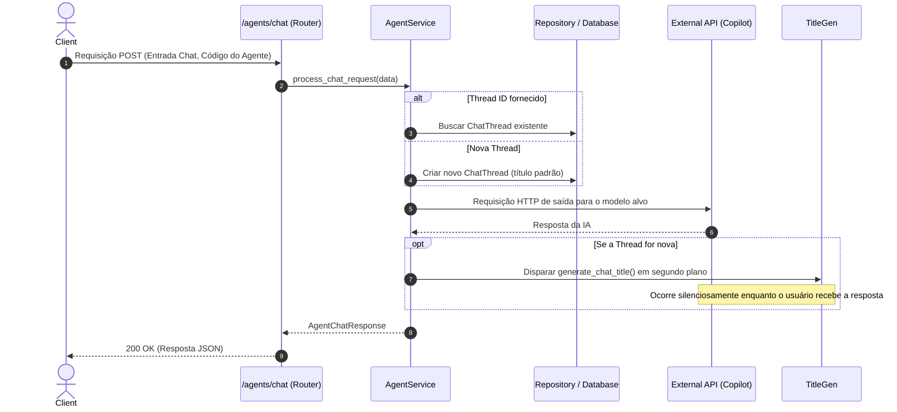
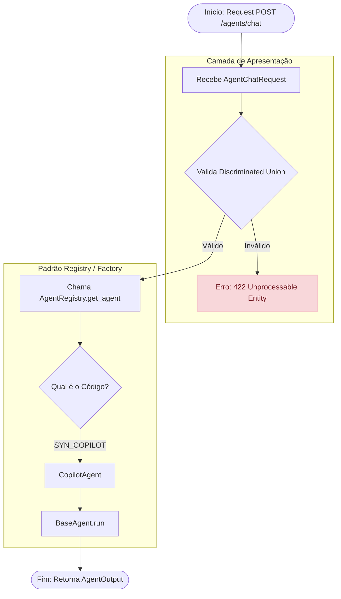
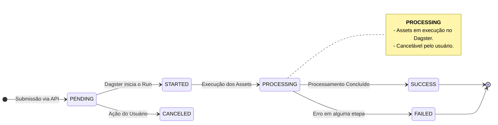
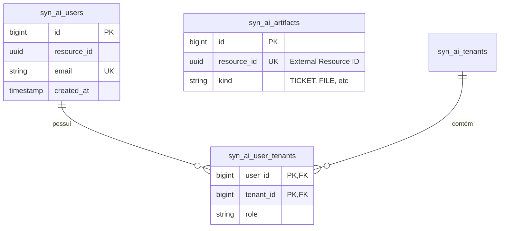

# Diagramas Mermaid

Referência de consulta antes de desenhar qualquer diagrama. Os templates foram extraídos dos 12 diagramas dos projetos
de origem; os nomes de componente e de tabela neles são exemplos, e não arquivos que precisem existir no seu
repositório.

## Índice

- [As duas âncoras textuais](#as-duas-%C3%A2ncoras-textuais)
- [Escolha do tipo](#escolha-do-tipo)
- [sequenceDiagram](#sequencediagram)
- [flowchart TD](#flowchart-td)
- [stateDiagram-v2](#statediagram-v2)
- [erDiagram](#erdiagram)
- [Convenções de rótulo](#conven%C3%A7%C3%B5es-de-r%C3%B3tulo)
- [Armadilhas de sintaxe](#armadilhas-de-sintaxe)
- [Diagramas fora do Mermaid](#diagramas-fora-do-mermaid)

## As duas âncoras textuais

Um diagrama nunca aparece sozinho. O padrão do corpus é:

1. **Parágrafo antes**, dizendo o que o diagrama mostra e por que ele importa. Sem heading entre o parágrafo e o bloco.

   > "O diagrama a seguir detalha o processo de busca em uma Base de Conhecimento, mostrando como a API combina busca
   > semântica (vetores) e lexical (palavras-chave)."

2. **Seção em prosa depois**, percorrendo as etapas, quando o fluxo tem decisões ou consequências que a figura não
   consegue carregar. Em `architecture.md` essa seção se chama "O Ciclo de Vida da Execução"; em `pr-agent-flow.md`,
   "Componentes Envolvidos". Ela numera as etapas e explica o *porquê* de cada uma.

Um diagrama simples e autoexplicativo dispensa a segunda âncora. A primeira é sempre necessária, porque é ela que
permite ao leitor decidir, ao passar os olhos, se aquele diagrama responde à sua dúvida.

## Escolha do tipo

| A pergunta que o diagrama responde | Tipo | Onde o corpus usa |
| -- | -- | -- |
| Quem chama quem, em que ordem, com que ramificações? | `sequenceDiagram` | fluxo de chat, autenticação, upload assíncrono, PR-Agent |
| Por onde o dado passa e onde o fluxo se ramifica? | `flowchart TD` | registry de agentes, pipeline de ingestão, busca híbrida |
| Que estados uma entidade assume e como transita? | `stateDiagram-v2` | ciclo de vida de job, ciclo de vida de thread |
| Como as tabelas se relacionam? | `erDiagram` | esquema de banco em `database/README.md` |

Se a resposta envolver tempo e atores, use sequência. Se envolver decisão sobre um dado em trânsito, use flowchart. O
erro mais comum é representar uma troca de mensagens entre serviços como flowchart, formato que não expressa a ordem
temporal.

## sequenceDiagram

Template com todos os recursos que o corpus usa:

````markdown

````

Convenções:

- **`autonumber`** quando a prosa vai referenciar as etapas por número. É o padrão.
- **`actor`** para o agente humano ou o cliente externo; **`participant`** para os componentes do sistema.
- **`alt`/`else`** para caminhos mutuamente exclusivos; **`opt`** para o que pode ou não acontecer; **`loop`** para
  ciclos de sensor ou polling.
- **`->>`** chamada, **`-->>`** retorno, **`-)`** chamada assíncrona que não bloqueia (usado no upload com background
  task).
- **`Note over A, B:`** para explicar comportamento que a seta não expressa, como assincronia, ausência de retorno ou
  efeito colateral.
- **`activate`/`deactivate`** apenas quando a duração da atividade for o ponto do diagrama.

Agrupar em fases nomeadas, como em `pr-agent-flow.md`, ajuda quando o fluxo passa de dez interações:

```mermaid
    Note over GL, S: Fase 1: Monitoramento Contínuo
```

## flowchart TD

````markdown

````

Convenções:

- **Formas com significado fixo**: `([texto])` início e fim; `[texto]` etapa de processamento; `{texto}` decisão;
  `(texto)` componente ou serviço; `[(texto)]` banco de dados ou armazenamento.
- **`subgraph` por camada arquitetural**, com o identificador em `snake_case` e o rótulo humano entre colchetes.
- **Comentários `%%`** nomeando os blocos do código-fonte do diagrama. Eles não aparecem na renderização; servem para
  quem for editar o diagrama depois.
- **`style` reservado para erro**, com a paleta usada no corpus: `fill:#f8d7da,stroke:#f5c6cb,color:#721c24`. Colorir
  o caminho de sucesso adiciona ruído visual sem distinguir nada.
- Rótulos de aresta descrevem a condição: `-- Sim -->`, `-- Não -->`, `-- SYN_COPILOT -->`, `-->|Gera Descrição|`.

`graph TD` também aparece no corpus e é equivalente; prefira `flowchart TD` em diagramas novos, que é a forma atual.

## stateDiagram-v2

````markdown

````

Os nomes dos estados são os valores reais do enum, em maiúsculas, sem tradução. Use `direction LR` para ciclos
lineares e `direction TB` quando houver muitas notas laterais. As `note` carregam as invariantes de cada estado, como a
condição registrada no banco e a visibilidade nas consultas, que é a informação difícil de inferir a partir da figura.

## erDiagram

````markdown

````

Nomes de tabela e de coluna exatamente como no banco. Marcações `PK`, `FK`, `UK` sempre presentes. A string entre aspas
após a coluna é um comentário renderizado; use-o para valores possíveis de enum ou origem do identificador. Comentários
`%%` agrupam as tabelas por domínio.

Cardinalidade: `||--o{` um-para-muitos, `}o--o{` muitos-para-muitos, `||--||` um-para-um. O rótulo do relacionamento é
um verbo em português entre aspas.

## Convenções de rótulo

- **Rótulo humano em português, identificador técnico no original.** O padrão de alias combina os dois:
  `participant S as Sensor Dagster<br/>(gitlab_mr_review_sensor)`.
- **`<br>` ou `<br/>` para quebra de linha** dentro de rótulo. Nunca use `\n`, porque nem todos os renderizadores do
  GitLab o interpretam; o corpus tem um caso legado que falha por esse motivo.
- Nome de tabela, endpoint, classe e variável de ambiente permanecem exatos, sem acento e sem tradução.
- Rótulos curtos. Se um nó precisa de mais de duas linhas, a explicação pertence à prosa, não à figura.

## Armadilhas de sintaxe

Estas quebram a renderização no GitLab sem gerar erro visível: o bloco passa a aparecer como texto puro.

| Problema | Sintoma | Correção |
| -- | -- | -- |
| Parênteses, vírgula ou `:` dentro de `[]` em flowchart | Diagrama não renderiza | Aspas: `A["Erro (422): payload inválido"]` |
| `end` como palavra isolada em rótulo | Fecha o bloco antes da hora | Reescreva o rótulo |
| `\n` em vez de `<br>` | Aparece o literal `\n` | Use `<br>` |
| Espaço em branco à direita das linhas | Falha intermitente de parsing | Remova; o `docfmt.py check` sinaliza |
| Acento em identificador de nó (`Início --> Fim`) | Parsing inconsistente | Identificador ASCII, rótulo acentuado: `Start([Início])` |
| `subgraph Nome Com Espaço` | Rótulo truncado | `subgraph nome_id [Nome Com Espaço]` |

Antes de commitar um diagrama novo, cole-o em <https://mermaid.live> e confirme que ele renderiza. A verificação leva
segundos e evita descobrir a falha durante a revisão do MR.

## Diagramas fora do Mermaid

Visões gerais desenhadas à mão — como o resumo de fluxo em `contributing.md` — usam Excalidraw exportado em SVG e
versionado junto do documento:

```markdown

```

Exporte com a opção que embute a cena no SVG, para que o arquivo continue editável no Excalidraw. Prefira Mermaid
sempre que a estrutura for regular, porque ele é versionável em texto e revisável em diff.
